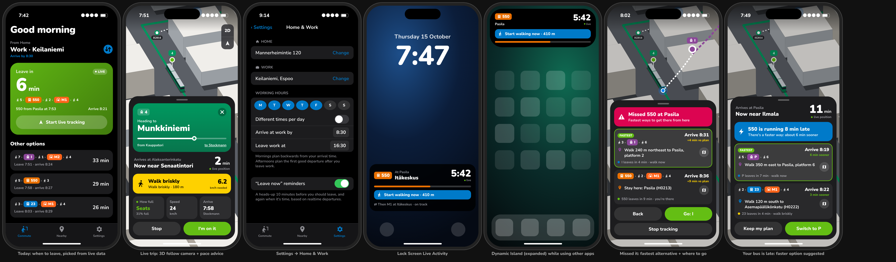

# HSL Commuter

A personal iOS 18 app for commuting in the Helsinki region. It computes **when your bus, tram, metro, train or ferry actually reaches your stop**, from the vehicle's live position. It also tells you whether to **relax, start walking, walk briskly, run, or give up and take the next one**: on a Live Activity, in the Dynamic Island, in widgets and through alerts. The live view follows your vehicle on a 3D Apple Maps view, with HSL-styled 3D vehicles.

See [PLAN.md](PLAN.md) for the design.

## Features

- **Arrival estimates from live vehicle positions.** HSL's high-frequency positioning feed (HFP) sends roughly one GPS fix per second per vehicle. The app projects each fix onto the route, smooths it with a filter, and adds stop-to-stop running times it learns on the device. Dwell times and timing points (where an early vehicle waits for the timetable) are included. The result is blended with Digitransit's own realtime estimate and shown as a range ("4–6 min") when the app is uncertain.
- **Road- and rail-following arrival times.** Arrival time is computed along the vehicle's actual route shape (Digitransit trip geometry, with MapKit street routing for buses if it's missing). Each stretch gets a speed limit from how sharply the route turns: bends, intersections, U-turns. The vehicle accelerates and brakes between those limits and into the stop, with a traffic factor per mode (bus, trunk bus, tram, metro, train, ferry). That physics is blended with learned and scheduled times, and the sheet shows the distance left "by road" or "by rail".
- **Starts by itself.** Leaving home within 2 hours before your arrive-by time, or leaving work around your leave time, on a workday starts live tracking automatically. iOS wakes the app for this. If tracking starts in the background, the Live Activity appears when you next open the app (an iOS limit without a push server).
- **Detects boarding and getting off.** It uses the motion sensors (walking or in a vehicle) and your distance to the live vehicle, so there's nothing to tap. The buttons are still there as a fallback.
- **Spoken and haptic cues.** Short voice prompts in English or Finnish ("Walk a bit faster. Bus 550 in 3 minutes, 240 metres to go." / "Your stop is next: Pasila. Then Metro M1 in 4 minutes, platform 2."), by default only with headphones, and briefly lowering your music. Haptics: one tap means go, two taps speed up, three taps run. Notifications use soft custom chimes, are grouped into one thread, and replace each other instead of piling up.
- **Learns you.** Using iOS visit data that stays on the phone, it suggests your home and work and offers to update your times ("You usually arrive around 8:20").
- **Knows your day.** Skips Finnish public holidays (Easter, Midsummer and All Saints' Day are calculated), offers "Working from home today" on the Today screen and the reminder notification, and can optionally read your calendar: an early first meeting moves the arrive-by time, and all-day "WFH", "Loma" or "Vacation" events skip the day.
- **Weather-aware.** FMI forecast and observations. Ice, snow and wind slow your assumed walking speed and add margin ("Slippery today: leave about 2 min earlier"). In cold, rain or wind it tells you to wait inside until it's time to leave.
- **Platforms that change.** Train track from Digitraffic, shown prominently, with an alert and a spoken prompt if it changes.
- **Disruptions in plain language.** HSL alerts matched to your exact trip ("Metro M2 isn't running. Your trip uses it. We'll find you another way."). A leg that isn't running triggers the fastest-alternative panel.
- **How full it is, from riders.** On about 1 in 3 rides, a minute or so after you board, the app asks once: *How full is 550? Seats / Standing / Full*. You can answer with one tap in the app, on the notification, or with buttons right on the Lock Screen Live Activity. Answers are anonymous (trip, level and time only) and are shared with other riders through the CloudKit public database. Rider reports show on the trip view and on the Today options ("Standing · 3 riders, 4 min ago"); where no one has answered, the vehicle's own sensor reading (HFP) is used.
- **Pace advice.** The app uses your walking distance (MapKit walking route) and your personal walking speed, which it learns while you walk. The states are: relax, leave soon, start walking, walk briskly, run, or you'll miss it.
- **Transfer guard.** While you're on the first vehicle, the app checks whether you'll make the next one and warns you early.
- **Home & Work setup.** Set your home, your work, the time you need to be at work and the time you leave work. You can use the same times every workday or different times per day. Mornings plan backwards from your arrival time; afternoons plan the first good departure after you leave work. The Today screen switches direction automatically at the middle of your working day.
- **Missed a connection?** When a vehicle leaves without you, a connection is predicted to fail, or you tap **I missed it**, the app re-plans from where you are (or from the stop you'll get off at). It shows the fastest alternatives you can still reach, with exactly where to go ("Walk 240 m northeast to Pasila, platform 2"), the walking path on the map, the pace you need, an Apple Maps walking-directions button, and how much later you'll arrive than planned. One tap switches live tracking to it.
- **Late vehicle, faster option.** If the vehicle you're heading for runs 2+ min late, the app checks every 90 seconds whether another reachable route gets you there at least 3 min sooner, and suggests switching ("550 is running 8 min late. There's a faster way: about 6 min sooner"). "Keep my plan" mutes it unless a clearly better option appears.
- **Departure picker.** Ranks options to minimise time spent standing at stops while still arriving on time.
- **Live Activity and Dynamic Island**, with a countdown that keeps ticking without any server.
- **"Leave now" reminders** using local notifications that are re-planned in background refresh. No server is needed.
- **Widgets.** Next departure on the home and lock screen, plus a "Start live tracking" button.
- **3D map.** Pitched follow camera with pre-rendered, camera-aligned vehicle sprites for every mode: bus, articulated trunk bus, U-bus, Artic tram, Raide-Jokeri light rail, M300 metro, Sm5 train and Suomenlinna-style ferry.
- **Every mode.** Bus, tram and metro positions come from HFP. Commuter trains also use Fintraffic Digitraffic GPS (matched automatically). Ferries use HFP or realtime data where available.

## Build and install (personal sideload)

Requirements: a Mac with **Xcode 16+**, an iPhone on **iOS 18+**, and a free or paid Apple ID.

1. Install XcodeGen: `brew install xcodegen`
2. `cp Config/Local.example.xcconfig Config/Local.xcconfig` and fill in:
   - `BUNDLE_ID_PREFIX`: anything unique, e.g. `com.yourname`
   - `DEVELOPMENT_TEAM`: your team ID (Xcode → Settings → Accounts)
   - `DIGITRANSIT_API_KEY`: optional here; you can also paste it in the app. Get a free key at <https://portal-api.digitransit.fi>.
3. `xcodegen generate && open HSLCommuter.xcodeproj`
4. Select your iPhone and press Run. On the phone, trust the developer profile under Settings → General → VPN & Device Management.
5. On first launch: paste the API key, allow location (**Always** gives the most reliable locked-screen tracking) and notifications, and set Home & Work (places, arrive-at-work and leave-work times).

**Free Apple ID notes**
- The app has to be re-installed from Xcode every **7 days**. A paid account ($99/yr) makes it last a year.
- If signing fails on the **Time Sensitive Notifications** entitlement, delete that key from `Config/HSLCommuter.entitlements`. Alerts then arrive as normal notifications.
- If signing fails on **App Groups**, remove the `com.apple.security.application-groups` entries from `Config/HSLCommuter.entitlements` and from `project.yml` (the widget target). Everything works except the home-screen widget, which will show "Open the app to plan". Live Activities don't need App Groups.

**Sharing "how full is it?" with other riders (optional, paid account)**
1. In `Config/Local.xcconfig` set `CROWD_SHARING = YES` and `ENTITLEMENTS_VARIANT = -CloudKit`, then run `xcodegen generate`.
2. Build once and answer a "how full?" question, so CloudKit creates the `OccupancyReport` record type.
3. In the CloudKit Console (container `iCloud.<your prefix>.commuter`), add indexes: `tripKey` queryable, `createdTimestamp` queryable and sortable.
4. Friends who install your build (same team and container) see each other's reports.

Without this, the app still asks, and your own answers are used on your phone.

## Station maps (indoor walking directions)

`tools/stations/build_stations.py` builds the indoor layout of every metro station, train station and major bus terminal from OpenStreetMap and Digitransit: entrances, levels, platforms, escalators, stairs, lifts and a walkable path network. The app bundles the result and routes through it ("Take the escalator down to level -1, walk 60 m to platform 2"), with a step-free option.

```
export DIGITRANSIT_API_KEY=...
python3 tools/stations/build_stations.py                 # all stations (~10 min, cached in tools/stations/.cache)
python3 tools/stations/build_stations.py --only Kamppi   # quick look at one
python3 tools/stations/build_stations.py --stations-file saved.json   # reuse a saved Digitransit `stations` response
python3 tools/stations/build_stations.py --inventory --stations-file saved.json   # station list only, no OSM
python3 -m unittest discover -s tools/stations            # offline tests
```

It writes `App/Resources/Stations/stations.json` and `docs/stations/coverage.md`. The current list of what it covers (116 stations: 49 train, 35 bus terminals, 30 metro, 2 Raide-Jokeri hubs) is in [docs/stations/inventory.md](docs/stations/inventory.md). The report rates each station *complete*, *partial* or *empty* and lists exactly what's missing in OpenStreetMap (entrances, platform levels, escalators, lifts, gaps in corridors), so you know where hand-mapping is needed.

## Project layout

```
project.yml                 XcodeGen spec (app + widget extension)
Config/                     xcconfig + generated Info.plists/entitlements
Packages/CommuterKit/       Swift package
  ETAEngine/                pure Swift: geometry, Kalman filter, segment model, ETA, pace, transfers
  HSLKit/                   Digitransit GraphQL, MQTT-over-WebSocket client, HFP, Digitraffic rail
  HSLDesign/                HSL colours/typography, line badges, 3D vehicle renderer + sprite cache
App/                        SwiftUI app: Today, live trip map + sheet, nearby stops, settings
  Services/CommuteSession   the live engine (vehicles + you → advice, Live Activity, alerts)
Shared/                     Live Activity attributes, App Group store, App Intent (app + widgets)
Widgets/                    Live Activity / Dynamic Island + next-departure widget
```

## Tests

`ETAEngine` and `HSLKit` have unit tests (geometry, filter, ETA, pace and transfer logic, HFP/MQTT/GraphQL decoding):

```
cd Packages/CommuterKit && swift test
```

## How it works while the phone is locked

There's no server. When you start live tracking (from the app, a reminder notification, the widget or Siri), the app starts a background location session, the same mechanism navigation apps use. That keeps the HFP connection and the Live Activity updating until you stop or arrive. Before the commute, when the app isn't running, reminders are scheduled ahead from realtime data and refreshed when iOS grants background refresh time. They're accurate to roughly a minute, and switch to second-level accuracy once tracking starts.

## Data and credits

Data from HSL / Digitransit (CC BY 4.0) and Fintraffic Digitraffic (CC BY 4.0). HSL colours are used for a personal, unofficial app. This app is not affiliated with HSL.

## UI mockups



These are HTML/CSS mockups of the SwiftUI screens, rendered in headless Chromium. They are not screenshots of the running app. The map uses a JavaScript port of the app's vehicle renderer, but it is drawn on a stand-in city, not Apple Maps. Source: `docs/mockups/index.html`.
